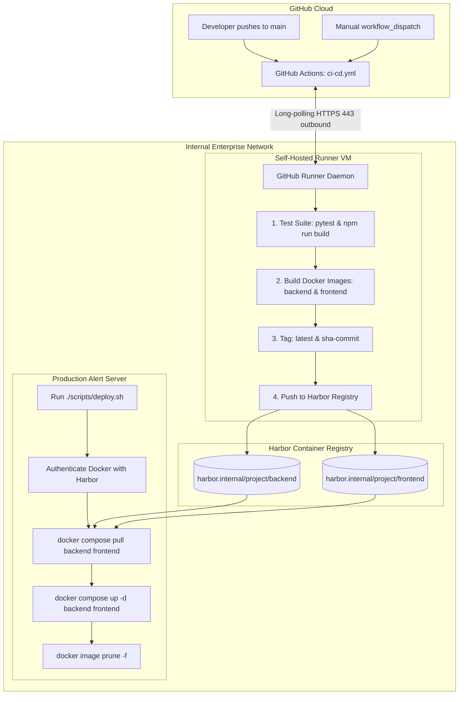

# CI/CD Pipeline & Harbor Deployment Guide

This guide describes how to configure the GitHub Actions automated CI/CD pipeline, register a GitHub Self-Hosted Runner on your internal network, and deploy pre-built Docker images from Harbor to your production server using [`scripts/deploy.sh`](file:///Users/kimsrung/workspace/nbc/dashboard_alert/scripts/deploy.sh).

---

## 1. Architecture Overview



---

## 2. GitHub Self-Hosted Runner Setup (Internal Linux VM)

Because Harbor is hosted on an internal private network, standard GitHub-hosted cloud runners cannot reach it. A **Self-Hosted Runner** runs directly inside your network and only requires **outbound HTTPS (port 443)** to `github.com`. No inbound firewall ports need to be opened.

### Step 2.1: Prerequisites on the Runner VM
Ensure the runner VM has Docker, Python 3.11, and Git installed:
```bash
# Verify Docker is running and the runner user has access
docker version
sudo usermod -aG docker $USER
newgrp docker
```

### Step 2.2: Download and Register the Runner
1. In your GitHub repository, navigate to **Settings** → **Actions** → **Runners**.
2. Click **New self-hosted runner** and select **OS: Linux**, **Architecture: x64** (or ARM64).
3. On your internal runner server, execute the commands provided by GitHub:
   ```bash
   # Create a directory for the runner
   mkdir -p ~/actions-runner && cd ~/actions-runner

   # Download the latest runner package (replace with URL from GitHub)
   curl -o actions-runner-linux-x64.tar.gz -L https://github.com/actions/runner/releases/download/v2.322.0/actions-runner-linux-x64-2.322.0.tar.gz
   tar xzf ./actions-runner-linux-x64.tar.gz

   # Configure the runner with your repo registration token
   ./config.sh --url https://github.com/<YOUR_ORG>/<YOUR_REPO> --token <REGISTRATION_TOKEN>
   ```
4. Accept defaults (or add tags `self-hosted`, `linux`).

### Step 2.3: Install as a Systemd Service (Persistent Background Daemon)
To keep the runner running automatically across server reboots:
```bash
sudo ./svc.sh install
sudo ./svc.sh start
sudo ./svc.sh status
```

---

## 3. GitHub Repository Secrets Configuration

Navigate to **Settings** → **Secrets and variables** → **Actions** → **New repository secret** and add the following 4 secrets:

| Secret Name | Example Value | Description |
| :--- | :--- | :--- |
| `HARBOR_URL` | `harbor.internal.nbc.gov.kh` | Harbor registry domain or IP (without `http://` or `https://`) |
| `HARBOR_PROJECT` | `security` | Target project or repository folder in Harbor |
| `HARBOR_USERNAME` | `robot$ci-deployer` or admin username | Harbor username or robot account name |
| `HARBOR_PASSWORD` | `<secret-token>` | Harbor user password or robot account token |

---

## 4. GitHub Actions CI/CD Pipeline

The workflow file is located at [`.github/workflows/ci-cd.yml`](file:///Users/kimsrung/workspace/nbc/dashboard_alert/.github/workflows/ci-cd.yml).

### Automated Pipeline Flow:
1. **Trigger**: Executes automatically on `git push` to `main`.
2. **Quality Gates (`test` job)**:
   - Backend: Sets up Python 3.11 and executes `pytest`.
   - Frontend: Executes `npm ci` and verifies TypeScript/Vite bundle with `npm run build`.
3. **Build & Push (`build-and-push` job)**:
   - Authenticates to Harbor via Docker CLI.
   - Builds both `backend` and `frontend` Docker images.
   - Pushes dual tags:
     - `${HARBOR_URL}/${HARBOR_PROJECT}/backend:latest`
     - `${HARBOR_URL}/${HARBOR_PROJECT}/backend:sha-<short-sha>`
     - `${HARBOR_URL}/${HARBOR_PROJECT}/frontend:latest`
     - `${HARBOR_URL}/${HARBOR_PROJECT}/frontend:sha-<short-sha>`

### Manual Trigger (`workflow_dispatch`):
You can trigger a build on demand from GitHub:
1. Navigate to **Actions** → **CI/CD Pipeline - Build, Test & Push to Harbor**.
2. Click **Run workflow**.
3. (Optional) Provide a `custom_tag` (e.g. `v1.2.0`) or toggle `skip_tests` for emergency releases.

---

## 5. On-Server Deployment (`scripts/deploy.sh`)

The deployment script [`scripts/deploy.sh`](file:///Users/kimsrung/workspace/nbc/dashboard_alert/scripts/deploy.sh) is a lightweight utility designed to be run directly on the production server.

### Step 5.1: Configure `.env.production`
Ensure your server's `.env.production` contains your Harbor configuration:
```bash
HARBOR_URL=harbor.internal.nbc.gov.kh
HARBOR_PROJECT=security
HARBOR_USERNAME=robot$ci-deployer
HARBOR_PASSWORD=<token>
```
*(If Docker on the server is already authenticated via `docker login harbor.internal.nbc.gov.kh`, `HARBOR_USERNAME` and `HARBOR_PASSWORD` in `.env.production` can remain blank).*

### Step 5.2: Deploy Latest Version
To pull and deploy the newest `latest` image:
```bash
./scripts/deploy.sh
```

### Step 5.3: Deploy or Rollback to a Specific Commit SHA
To deploy an exact build or rollback instantly:
```bash
# Deploy a specific git commit SHA tag
./scripts/deploy.sh sha-3a7b9c1

# Deploy a specific semantic version tag
./scripts/deploy.sh v1.0.4
```

### What `scripts/deploy.sh` Does:
1. Validates `.env.production` and target image tags.
2. Authenticates to Harbor (reuses existing docker session if available).
3. Pulls the new backend and frontend images (`docker compose pull backend frontend`).
4. Recreates and restarts backend and frontend containers with zero downtime (`docker compose up -d backend frontend`).
5. Prunes obsolete dangling layers to reclaim disk space (`docker image prune -f`).
6. Prints the live container status.
