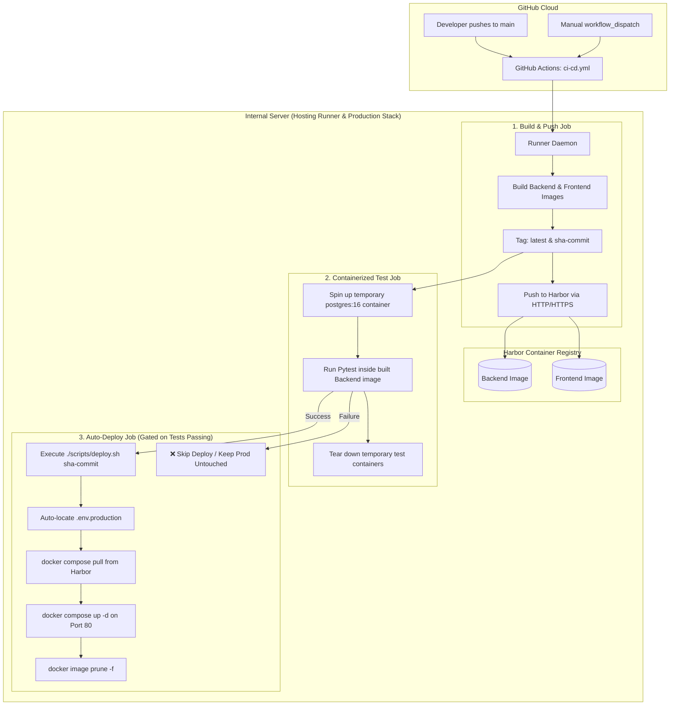

# CI/CD Pipeline & Harbor Deployment Guide

This guide describes how to configure the GitHub Actions automated CI/CD pipeline, register a GitHub Self-Hosted Runner on your internal network, and deploy pre-built Docker images from Harbor to your production server using [`scripts/deploy.sh`](file:///Users/kimsrung/workspace/nbc/dashboard_alert/scripts/deploy.sh).

---

## 1. Architecture Overview



---

## 2. GitHub Self-Hosted Runner Setup (Internal Linux VM)

Because Harbor is hosted on an internal private network, standard GitHub-hosted cloud runners cannot reach it. A **Self-Hosted Runner** runs directly inside your network and only requires **outbound HTTPS (port 443)** to `github.com`. No inbound firewall ports need to be opened.

### Step 2.1: Prerequisites on the Server
Ensure Docker is installed and your user has access to Docker:
```bash
# Verify Docker is running and current user has access
docker version
sudo usermod -aG docker $USER
newgrp docker
```

### Step 2.2: Download and Register the Runner
1. In your GitHub repository, navigate to **Settings** → **Actions** → **Runners**.
2. Click **New self-hosted runner** and select **OS: Linux**, **Architecture: x64** (or ARM64).
3. On your internal server, execute the commands provided by GitHub:
   ```bash
   # Create a directory for the runner
   mkdir -p ~/actions-runner && cd ~/actions-runner

   # Download the latest runner package
   curl -o actions-runner-linux-x64.tar.gz -L https://github.com/actions/runner/releases/download/v2.322.0/actions-runner-linux-x64-2.322.0.tar.gz
   tar xzf ./actions-runner-linux-x64.tar.gz

   # Configure the runner with your repo registration token
   ./config.sh --url https://github.com/<YOUR_ORG>/<YOUR_REPO> --token <REGISTRATION_TOKEN>
   ```
4. Press Enter to accept the default runner name and labels.

### Step 2.3: Install as a Systemd Service (Persistent Background Daemon)
To keep the runner running automatically across server reboots:
```bash
sudo ./svc.sh install
sudo ./svc.sh start
sudo ./svc.sh status
```

---

## 3. GitHub Repository Secrets & Variables Configuration

You can configure your Harbor credentials in your GitHub repository under **Settings** → **Secrets and variables** → **Actions** (either in the **Secrets** tab or the **Variables** tab):

| Configuration Key | Example Value | Description |
| :--- | :--- | :--- |
| `HARBOR_URL` | `http://10.20.40.55/` or `10.20.40.55` | Harbor registry domain or IP |
| `HARBOR_PROJECT` | `alert-dashboard` | Target project or repository folder in Harbor |
| `HARBOR_USERNAME` | `itsec` or `robot$ci-deployer` | Harbor username or robot account name |
| `HARBOR_PASSWORD` | `<your-password>` | Harbor user password or robot account token |

*(The pipeline automatically checks both `secrets.*` and `vars.*`, so credentials can be placed in either section).*

---

## 4. HTTP Harbor Registry Support (`insecure-registries`)

If Harbor is running on plain HTTP (port 80) without SSL/TLS, Docker by default rejects it because Docker enforces HTTPS (port 443).

The deployment script and CI/CD workflow automatically ensure that your Harbor IP is added to Docker's `insecure-registries` in `/etc/docker/daemon.json`:
```json
{
  "insecure-registries": ["10.20.40.55"]
}
```
If configuring manually on the server:
```bash
sudo mkdir -p /etc/docker
sudo tee /etc/docker/daemon.json << 'EOF'
{
  "insecure-registries": ["10.20.40.55"]
}
EOF
sudo systemctl daemon-reload
sudo systemctl restart docker
```

---

## 5. Automated 3-Stage CI/CD Pipeline

The workflow file is located at [`.github/workflows/ci-cd.yml`](file:///Users/kimsrung/workspace/nbc/dashboard_alert/.github/workflows/ci-cd.yml).

### Stage 1: Build & Push to Harbor (`build-and-push`)
- Authenticates to Harbor via Docker CLI.
- Builds backend and frontend production images.
- Frontend image compilation validates all TypeScript and Vite bundle logic during Docker build (`npm run build`).
- Pushes dual tags to Harbor:
  - `${HARBOR_URL}/${HARBOR_PROJECT}/backend:latest`
  - `${HARBOR_URL}/${HARBOR_PROJECT}/backend:sha-<short-sha>`
  - `${HARBOR_URL}/${HARBOR_PROJECT}/frontend:latest`
  - `${HARBOR_URL}/${HARBOR_PROJECT}/frontend:sha-<short-sha>`

### Stage 2: Containerized Test Suite (`test`)
- Runs on the self-hosted runner.
- Spins up an isolated, temporary `postgres:16-alpine` database container on a private bridge network (`ci_net_<run_id>`).
- Runs `pytest` **inside the freshly built backend Docker image**, testing the exact image that was pushed to Harbor.
- Zero host dependencies needed (no host Python or host database).
- Automatically tears down the test database container and network when finished.

### Stage 3: Auto-Deploy to Production (`deploy`)
- **Gated**: Executes only when Stage 2 tests pass (`if: needs.test.result == 'success'`).
- If tests fail, deployment is automatically **skipped**, keeping production safe.
- Automatically copies `.env.production` from the host repository directory (`~/alert-dashboard/.env.production`) if running from the runner workspace.
- Runs `./scripts/deploy.sh sha-<short-sha>` to pull the images and restart the stack on port 80.

---

## 6. Manual On-Server Deployment (`scripts/deploy.sh`)

You can also run [`scripts/deploy.sh`](file:///Users/kimsrung/workspace/nbc/dashboard_alert/scripts/deploy.sh) manually on the production server at any time:

```bash
# Pull and deploy latest images from Harbor
./scripts/deploy.sh

# Deploy or rollback to a specific commit SHA tag
./scripts/deploy.sh sha-3a7b9c1

# View help and usage
./scripts/deploy.sh --help
```

### What `scripts/deploy.sh` Does:
1. Locates `.env.production` (searching current directory, `~/alert-dashboard`, and standard server paths).
2. Sets up Docker `insecure-registries` if Harbor runs on HTTP.
3. Authenticates to Harbor (reuses existing docker session if available).
4. Pulls the new backend and frontend images (`docker compose pull backend frontend`).
5. Recreates and restarts backend and frontend containers with zero downtime (`docker compose up -d backend frontend`).
6. Prunes obsolete dangling layers to reclaim disk space (`docker image prune -f`).
7. Prints the live container status on port 80.
