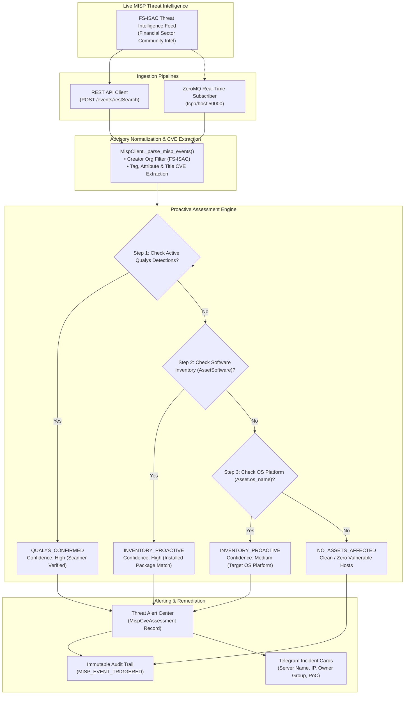

# MISP Threat Intelligence & Proactive Assessment Guide

This document explains the architecture, operational workflow, and configuration of the **MISP (Malware Information Sharing Platform)** integration within the Risk Alert Dashboard.

It details how CVE advisories are synchronized, how the platform proactively evaluates exposure against infrastructure inventory, and how to operate **FS-ISAC** live threat intelligence feeds.

---

## 1. Executive Summary & Core Philosophy

Traditional vulnerability management relies entirely on active vulnerability scanner scans (e.g., Qualys). While highly accurate, scanners suffer from a fundamental timing gap:

```
[Threat Published / Zero-Day Announced] 
    → Scanner Vendor Authors QID (1–7 days)
    → Scheduled Scanner Sweep Runs (Weekly/Monthly)
    → Vulnerability Finally Flagged (Total Lag: Days to Weeks)
```

The **MISP Proactive Threat Assessment Engine** bridges this gap. When emergency CVE advisories arrive via MISP feeds, the engine immediately compares the advisory's vulnerable package and version specifications against the local software inventory (`AssetSoftware`), which is continuously populated from host discovery scans:

```
[Threat Published / Zero-Day in MISP]
    → Ingested via ZeroMQ Stream or REST Sync (Seconds)
    → Proactive Engine Matches Installed Packages & OS (Instant)
    → Alert Generated & Telegram Dispatched with Fix Guide (Instant)
```

---

## 2. System Architecture & Data Flow

The following diagram illustrates the complete end-to-end lifecycle of threat intelligence from ingestion to remediation:



---

## 3. How MISP Synchronization Works

The platform supports two complementary synchronization mechanisms:

### A. REST API Polling (`/events/restSearch`)
- **Trigger**: Runs periodically on a background schedule (APScheduler, default: every 2 hours) or on-demand when an administrator clicks the **Sync Feed** button in the **MISP Threat Feed** sub-module (`/misp`). The Alert Center provides a dedicated database **Refresh** button.
- **Endpoint**: `POST {MISP_URL}/events/restSearch`
- **Request Payload**:
  ```json
  {
    "enforceWarninglist": true,
    "limit": 1000,
    "quickFilter": "CVE",
    "org": "FS-ISAC"
  }
  ```
  *(Note: If `MISP_CREATOR_ORG` is set to `*`, the `"org"` field is omitted so MISP returns events from all publishing organizations. If `MISP_TAG_FILTER` is configured, `"tags": [MISP_TAG_FILTER]` is included).*
- **Authentication**: HTTP Header `Authorization: {MISP_API_KEY}`.
- **SSL Verification**: Enterprise internal SSL certificates are accepted seamlessly via async HTTP client settings (`verify=False` if custom internal CA).

### B. ZeroMQ Real-Time Event Streaming (`tcp://<host>:50000`)
- **Trigger**: Event-driven streaming directly from MISP's native ZeroMQ publisher.
- **Topics**: Subscribes to `misp_json_event`, `misp_json`, and `misp_json_attribute`.
- **Workflow**:
  1. Whenever a threat analyst or synchronization feed creates or modifies an event in MISP, MISP publishes the event payload over TCP.
  2. The background worker (`misp_zmq_subscriber.py`) receives the multi-frame payload, decodes the JSON event, and parses CVE metadata.
  3. The engine immediately triggers the proactive assessment workflow without waiting for the next periodic REST poll.
  4. If servers in inventory are affected, a Telegram alert card is dispatched immediately.

---

## 4. When New CVEs Arrive: The Evaluation Engine

When an advisory is ingested, the engine processes it through four distinct phases:

### Phase 1: Comprehensive CVE Extraction
Threat actors and intel teams tag CVEs differently. The normalization function [`_parse_misp_events`](file:///Users/kimsrung/workspace/nbc/dashboard_alert/backend/app/services/misp_client.py) extracts distinct CVEs from multiple locations:
1. **Event Taxonomy Tags**: Regex matching `\b(CVE-\d{4}-\d{4,})\b` across all attached tags (e.g. `vulnerability:CVE-2024-6387`).
2. **Direct Event Attribute**: Explicit `cve_id` fields on the MISP event.
3. **Attribute Values & Comments**: Every attribute of type `vulnerability`, `text`, or `comment`.
4. **Event Title & Description**: Regex extraction from the event title, info string, and summary text.

### Phase 2: Product Name & Alias Normalization
Software packages often have different names in threat intel feeds than their executable package names on Linux/Windows hosts. The engine uses a product alias dictionary (`PRODUCT_ALIASES`):

| Target Product | Monitored Inventory Package Names |
|---|---|
| `openssh` | `openssh`, `sshd`, `openssh-server`, `openssh-client`, `ssh` |
| `nginx` | `nginx`, `nginx-core`, `nginx-common`, `nginx-full` |
| `xz-utils` | `xz`, `xz-utils`, `liblzma`, `liblzma5` |
| `php` | `php`, `php-cgi`, `php-fpm`, `php-cli`, `php8` |
| `runc` | `runc`, `containerd`, `docker-runc` |
| `log4j` | `log4j`, `log4j-core`, `apache-log4j` |
| `openssl` | `openssl`, `libssl`, `libssl3`, `libcrypto` |
| `postgresql` | `postgresql`, `postgres`, `psql` |

### Phase 3: Version Comparison Algorithm
Version criteria in threat advisories can take multiple syntax forms:
- Inequality operators: `< 9.8p1`, `<= 1.25.2`, `>= 1.24.0, < 1.25.3`
- Exact version enumerations: `5.6.0, 5.6.1`

The function [`is_version_vulnerable`](file:///Users/kimsrung/workspace/nbc/dashboard_alert/backend/app/services/proactive_assessment_engine.py) tokenizes alphanumeric version numbers (such as `8.9p1` or `1.25.2-1ubuntu1`) into comparable numeric/string tuples. If the host's installed software satisfies all vulnerable conditions, it is flagged as affected.

### Phase 4: Match Classification & Evidence Generation
Each asset evaluated receives a classification and diagnostic evidence:
- **`QUALYS_CONFIRMED`** (Confidence: `High`): The Qualys scanner has already detected this QID on the asset. Scanner proof is attached.
- **`INVENTORY_PROACTIVE`** (Confidence: `High`): The host software inventory contains an installed package within the vulnerable version range, even though Qualys has not yet flagged it. Includes package name, version, path, and listening port.
- **`INVENTORY_PROACTIVE`** (Confidence: `Medium`): The target software affects an operating system platform (e.g., Linux Kernel) matching the asset's operating system.
- **`NO_ASSETS_AFFECTED`**: Evaluated against all assets; zero servers run the vulnerable software.

---

## 5. Production MISP (FS-ISAC) Configuration Reference

All threat intelligence ingestion parameters can be configured either via the Admin Settings web interface (`/settings`) or through environment variables in `.env`.

### Environment Variables Reference

| Variable | Description | Production Value (FS-ISAC) |
|---|---|---|
| `MISP_URL` | Base URL of the live MISP instance | `https://misp.fsisac.com` (or internal proxy IP) |
| `MISP_API_KEY` | MISP user authentication key | *(Secret Production Auth Key)* |
| `MISP_CREATOR_ORG` | Creator organization filter (`Orgc`) | `FS-ISAC` |
| `MISP_TAG_FILTER` | Taxonomy tag pattern filter | `vulnerability:CVE%` |
| `MISP_FEED_TAG` | Feed identifier tag in dashboard | `FS-ISAC` |
| `MISP_ENABLED` | Enable MISP integration | `true` |
| `MISP_SYNC_INTERVAL_HOURS` | Frequency of periodic REST poll | `2` (Hours) |
| `MISP_ZMQ_ENABLED` | Enable real-time ZeroMQ stream listener | `true` |
| `MISP_ZMQ_HOST` | ZeroMQ publisher TCP host / IP | `10.20.40.19` (or MISP server IP) |
| `MISP_ZMQ_PORT` | ZeroMQ publisher TCP port | `50000` |
| `MISP_ZMQ_USERNAME` | PLAIN authentication username (optional) | `misp_alert_subscriber` |
| `MISP_ZMQ_PASSWORD` | PLAIN authentication password (optional) | *(Encrypted subscriber secret)* |

### Recommended Production `.env` Snippet

```bash
# MISP Live Integration (FS-ISAC)
MISP_URL=https://misp-itsec.nbc.gov.kh
MISP_API_KEY=YOUR_PRODUCTION_FS_ISAC_AUTH_KEY
MISP_CREATOR_ORG=FS-ISAC
MISP_TAG_FILTER=vulnerability:CVE%
MISP_FEED_TAG=FS-ISAC
MISP_ENABLED=true
MISP_SYNC_INTERVAL_HOURS=2

# MISP Real-Time ZeroMQ Stream
MISP_ZMQ_ENABLED=true
MISP_ZMQ_HOST=10.20.40.19
MISP_ZMQ_PORT=50000
MISP_ZMQ_USERNAME=misp_alert_subscriber
MISP_ZMQ_PASSWORD=YourStrongSubscriberPassword
```

---

## 6. Real-Time Event Stream Configuration (ZeroMQ)

In addition to scheduled REST polling, the platform connects directly to MISP's native TCP ZeroMQ publisher (`tcp://host:50000`). When financial sector CVE advisories are published in MISP, the background subscriber receives the event within milliseconds.

### ZeroMQ Ingestion Architecture

```
┌─────────────────────────────────┐
│ Live MISP Server (10.20.40.19)  │
│ └── ZeroMQ Publisher (:50000)   │
└────────────────┬────────────────┘
                 │ TCP Stream ('misp_json_event')
                 ▼
┌─────────────────────────────────┐
│ misp_zmq_subscriber.py          │
│ ├── Validates Orgc == 'FS-ISAC' │
│ └── Extracts CVE, Product, Ver  │
└────────────────┬────────────────┘
                 │ Instant Evaluation
                 ▼
┌─────────────────────────────────┐
│ Proactive Assessment Engine     │
│ ├── Correlates AssetSoftware    │
│ ├── Creates Threat Alert        │
│ └── Dispatches Telegram Card    │
└─────────────────────────────────┘
```

1. **PLAIN Authentication Support**: Supports optional username/password authentication configured in MISP's ZeroMQ plugin.
2. **Automatic Reconnection**: Automatically detects broken TCP connections and reconnects with exponential backoff.
3. **Event Deduplication**: Filters candidate advisories through `ProactiveAssessmentEngine` to prevent duplicate alert storms.

---

## 7. Troubleshooting & FAQ

### Q1: Why does httpx fail with SSL certificate verification errors?
- **Cause**: Internal enterprise network gateways or internal CA endpoints may use enterprise self-signed certificates.
- **Solution**: The backend client [`MispClient`](file:///Users/kimsrung/workspace/nbc/dashboard_alert/backend/app/services/misp_client.py) passes `verify=False` to httpx, allowing safe communication with internal CA endpoints.

### Q2: How do I test real-time stream ingestion before production zero-days occur?
- In **Admin Settings** (`/settings`), use the **Real-Time Threat Event Simulator**.
- Click **Simulate ZeroMQ Threat Event** to push a sample FS-ISAC OpenSSH advisory (`CVE-2024-6387`, product `openssh`, criteria `< 9.8p1`).
- The engine will immediately evaluate all servers in your database running OpenSSH and generate a proactive alert with diagnostic proof.

### Q3: How is server point of contact (PoC) included in threat notifications?
- Whenever an advisory matches one or more servers, the engine looks up `asset.poc_name` and `asset.poc_email`.
- Telegram notification cards include both the shared ownership group (`asset.owner_username`) and the direct human contact (`asset.poc_name <asset.poc_email>`) for immediate response coordination.
- The engine will simulate an incoming ZeroMQ stream and evaluate all servers in your database running OpenSSH.

### Q4: How is server point of contact (PoC) included in threat notifications?
- Whenever an advisory matches one or more servers, the engine looks up `asset.poc_name` and `asset.poc_email`.
- Telegram notification cards include both the shared ownership group (`asset.owner_username`) and the direct human contact (`asset.poc_name <asset.poc_email>`) for immediate response coordination.
