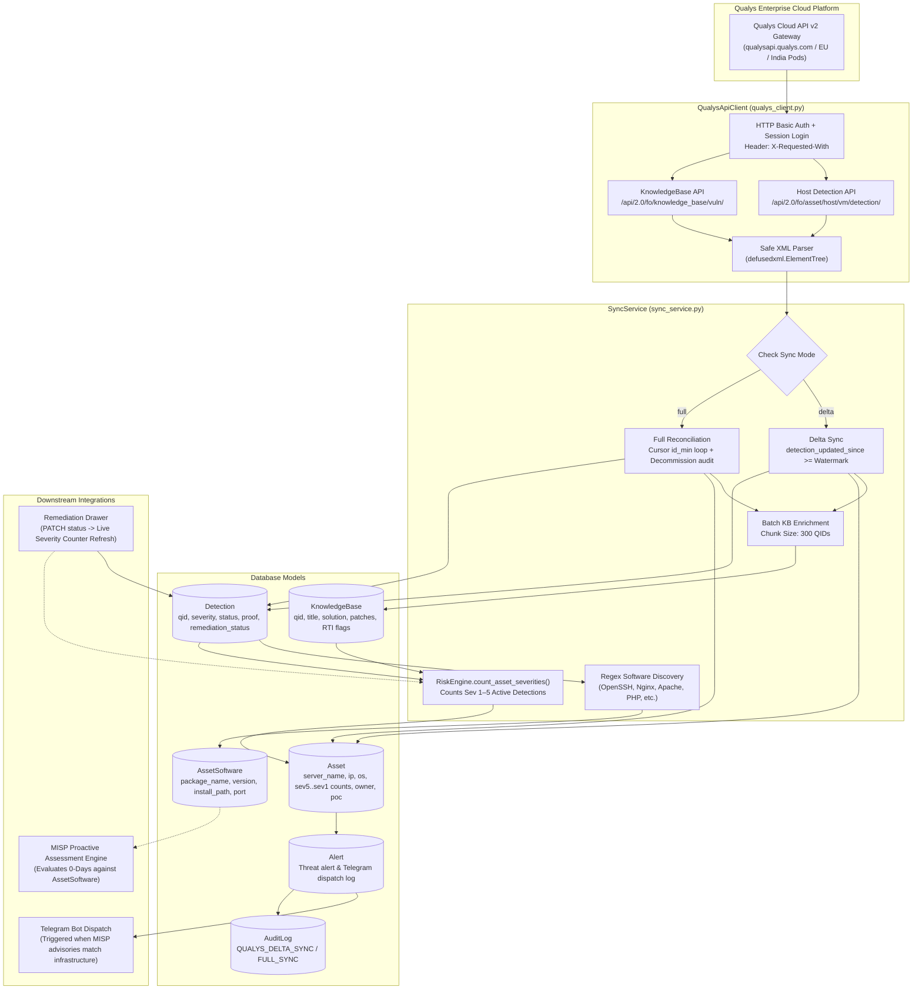
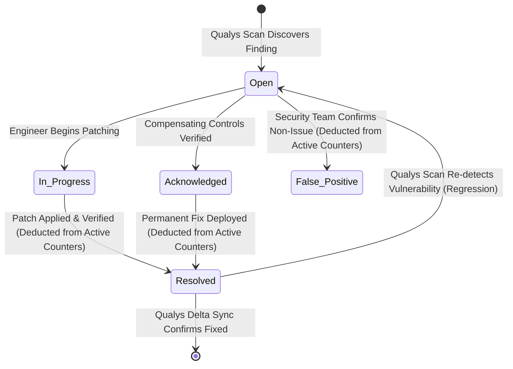

# Qualys Cloud Platform Integration & Synchronization Guide

This document explains the architecture, operational mechanics, synchronization engine, and raw Qualys Severity tracking of the **Qualys Cloud Platform Vulnerability Management (VM)** integration within the Risk Alert Dashboard.

---

## 1. Executive Summary & Capabilities

The Qualys integration continuously ingests vulnerability posture, asset inventory, operating system data, and scanner diagnostic proof from the **Qualys Enterprise Cloud Platform**. 

### Core Capabilities
1. **Automated Host Discovery & Reconciliation**: Ingests scanned assets, IP/IPv6 addresses, FQDNs, NetBIOS names, OS families, and asset tags.
2. **Dual-Mode Sync (Delta vs. Full)**:
   - **Incremental Delta Sync**: Queries detections modified since the last recorded watermark, completing in seconds.
   - **Full Inventory Reconciliation**: Paginates the complete host catalog, refreshes all vulnerability detections, and identifies decommissioned servers.
3. **KnowledgeBase (KB) Auto-Enrichment**: Batches unknown QIDs in chunks of 300 to retrieve step-by-step remediation advice, vendor patch links, CVSS v2/v3 scores, and Real-Time Threat Intelligence (RTI) indicators.
4. **Software Inventory Discovery (`AssetSoftware`)**: Regex extracts software packages (OpenSSH, Nginx, Apache HTTPD, PHP, Linux Kernel, etc.) directly from scanner diagnostic proof, populating the inventory used by the **MISP Proactive Assessment Engine**.
5. **Raw Qualys Severity Tracking Engine**: Tracks and aggregates findings directly by raw Qualys Severity 1–5 (Sev 5 Critical, Sev 4 High, Sev 3 Medium, Sev 2 Low, Sev 1 Info), eliminating artificial synthetic score calculations.
6. **Remediation Action Tracking**: Interactive slide-over drawer enabling security engineers to update remediation status (`Open`, `In_Progress`, `Acknowledged`, `False_Positive`, `Resolved`), with automatic real-time asset severity counter recalculation.
7. **Proactive Threat Alerting**: Dispatches Telegram alert cards with server name, IP, group ownership, and Point of Contact (PoC) when high-confidence zero-day threat advisories match monitored infrastructure.

---

## 2. System Architecture & Data Flow

The following diagram illustrates how Qualys data flows into the platform, updates the database, feeds software inventory into the MISP engine, and updates severity counters:



---

## 3. Qualys API v2 Specifications

### A. Authentication & Required Headers
Every HTTP request to the Qualys API requires a custom header identifying the client application:
```http
X-Requested-With: QualysDashboardAlert
Accept: text/xml, application/xml
Authorization: Basic <base64_encoded_credentials>
```

The connection tester [`QualysApiClient.test_connection()`](file:///Users/kimsrung/workspace/nbc/dashboard_alert/backend/app/services/qualys_client.py) verifies credentials by invoking `/api/2.0/fo/session/` with `action=login` and cleanly terminating with `action=logout`.

### B. Host VM Detection Endpoint
- **URL**: `POST {QUALYS_API_URL}/api/2.0/fo/asset/host/vm/detection/`
- **Standard Request Parameters**:
  ```http
  action=list
  output_format=XML
  show_igs=0
  show_tags=1
  status=Active,New,Re-Opened,Fixed
  severities=1,2,3,4,5
  ```
- **Tag Filtering**: When `QUALYS_TAG_FILTER` is defined in `.env` (e.g. `Production,Core-Banking`), the query includes:
  ```http
  tag_set_by=name
  tag_set_include=Production,Core-Banking
  ```
- **Watermark Parameter (Delta Sync)**:
  ```http
  detection_updated_since=2026-10-24T18:00:00Z
  ```
- **Cursor Pagination Parameter**:
  ```http
  id_min=1054200
  ```

### C. KnowledgeBase Endpoint
- **URL**: `POST {QUALYS_API_URL}/api/2.0/fo/knowledge_base/vuln/`
- **Request Parameters**:
  ```http
  action=list
  details=All
  ids=378291,376241,91942,150682,38914
  ```
- **Batching Strategy**: To avoid exceeding HTTP POST buffer limits and gateway timeouts, [`fetch_and_parse_kb_for_qids`](file:///Users/kimsrung/workspace/nbc/dashboard_alert/backend/app/services/qualys_client.py) splits lists of missing QIDs into chunks of **300 QIDs** per request.

### D. Safe XML Entity Parsing
All XML responses from Qualys are parsed using `defusedxml.ElementTree`:
```python
import defusedxml.ElementTree as ET
root = ET.fromstring(xml_content)
```
> [!IMPORTANT]
> Standard Python `xml.etree.ElementTree` is strictly forbidden across this codebase to prevent XML Entity Expansion (Billion Laughs) and XXE attacks from external payload injection.

---

## 4. Synchronization Mechanics: Delta vs. Full Reconciliation

The platform implements two distinct synchronization workflows in [`SyncService.run_sync()`](file:///Users/kimsrung/workspace/nbc/dashboard_alert/backend/app/services/sync_service.py):

| Attribute | Incremental Delta Sync (`delta`) | Full Inventory Reconciliation (`full`) |
|---|---|---|
| **Trigger** | Periodic background job (every 6 hours) or manual UI click | Admin manual trigger or initial system startup |
| **Qualys Query** | `detection_updated_since=<watermark>` | Paginates through all hosts (`id_min`) |
| **Average Duration** | 2 to 10 seconds | 30 to 180 seconds (depending on host volume) |
| **New & Active Findings** | Upserted & recalculated | Upserted & recalculated |
| **Fixed Findings** | Automatically marked `Resolved` in DB | Automatically marked `Resolved` in DB |
| **Decommissioned Assets** | Ignored (unmodified hosts not returned) | Detects inactive servers (`is_active = False`) |
| **API Quota Consumption** | Low (only altered records returned) | Moderate (scans entire infrastructure catalog) |

---

### Step-by-Step Sync Lifecycle

```
[Sync Trigger: Manual UI or Scheduler]
   │
   ├─► 1. Acquire Concurrency Lock (sync_lock prevents overlapping jobs)
   │
   ├─► 2. Resolve Watermark
   │      ├─ If delta mode & watermark exists ──► use qualys_last_sync_watermark
   │      └─ If watermark missing ──────────────► automatically promote to FULL sync
   │
   ├─► 3. Stream Host Detections with Pagination Loop
   │      └─ Inspect XML WARNING (Code 1905) ──► loop with id_min until complete
   │
   ├─► 4. Collect Missing QIDs & Enrich KnowledgeBase
   │      └─ Query DB for existing QIDs ───────► chunk missing QIDs (300/chunk) -> KB API
   │
   ├─► 5. Upsert Assets & Reconcile Host Identity
   │      └─ Match qualys_id ──────────────────► update server_name, IP, OS, tags
   │
   ├─► 6. Reconcile Vulnerability Detections
   │      ├─ If status == 'Fixed' ─────────────► set remediation_status = 'Resolved'
   │      ├─ If newly found ───────────────────► create Detection (status = 'Open')
   │      └─ If previously Resolved reopened ──► reset remediation_status = 'Open'
   │
   ├─► 7. Extract Installed Software
   │      └─ Parse scanner_results ────────────► upsert AssetSoftware inventory
   │
   ├─► 8. Execute RiskEngine Severity Counter Update
   │      └─ Count active Sev 1–5 detections (critical_vulns, high_vulns, medium_vulns, low_vulns, info_vulns, total_vulns)
   │
   ├─► 9. Evaluate Risk Breach & Audit Logging
   │      └─ Routine Qualys scan sync is excluded from Telegram alerts (prevent spam; alerts reserved for MISP threat matches)
   │
   ├─► 10. Decommission Inactive Assets (Full Sync Only)
   │       └─ Compare active DB assets against Qualys seen IDs ──► set is_active = False
   │
   └─► 11. Record System Watermark & Audit History
           └─ Commit transaction, log QUALYS_DELTA_SYNC / QUALYS_FULL_SYNC in AuditLog
```

---

## 5. Software Inventory Discovery Bridge to MISP

During every sync cycle, [`SyncService._sync_discovered_software`](file:///Users/kimsrung/workspace/nbc/dashboard_alert/backend/app/services/sync_service.py) parses the diagnostic text (`scanner_results`) of all detections on each host.

### Discovered Package Signatures

```python
# OpenSSH detection example
# Diagnostic snippet: "OpenSSH_8.2p1 Ubuntu-4ubuntu0.13"
m = re.search(r"OpenSSH[_-]([0-9a-zA-Z._-]+)", results, re.IGNORECASE)
if m:
    discovered.append({
        "product_name": "openssh",
        "vendor": "OpenBSD",
        "version": m.group(1),              # "8.2p1"
        "package_name": "openssh-server",
        "install_path": "/usr/sbin/sshd",
        "port": 22,
    })
```

The engine extracts:
- **OpenSSH**: Parses daemon version (e.g., `8.2p1`, `9.6p1`).
- **Nginx**: Parses web server version and install paths.
- **Apache HTTPD**: Extracts server string (e.g., `Apache/2.4.52`).
- **PHP**: Detects PHP CGI/FPM versions (e.g., `8.1.2`).
- **PostgreSQL / MySQL / MariaDB**: Captures database version strings and ports.
- **Linux Kernel**: Maps platform releases (e.g., `5.15.0-105-generic`).

### How This Bridges to MISP
When an emergency zero-day advisory (such as `CVE-2024-6387` regreSSHion) arrives via MISP (FS-ISAC), the **Proactive Assessment Engine** queries `AssetSoftware` directly. It immediately identifies which servers are running OpenSSH `< 9.8p1` **without waiting for Qualys to write, publish, and scan for a new QID**.

---

## 6. Raw Qualys Severity 1–5 Tracking Engine

The platform tracks and categorizes vulnerabilities by their native **Qualys Severity levels (Severity 1 to 5)** via [`RiskEngine.count_asset_severities()`](file:///Users/kimsrung/workspace/nbc/dashboard_alert/backend/app/services/risk_engine.py). This replaces artificial synthetic scoring formulas with clean, unmanipulated scanner reality.

---

### Qualys Severity Classification & Definitions

| Qualys Severity | Classification | Impact & Threat Definition | Color Badge |
|---|---|---|---|
| **Severity 5** | **Critical** | Urgent vulnerabilities that could be exploited remotely to take complete control of the host (e.g. root/administrator Remote Code Execution, authentication bypass). | Red (`bg-red-500/10 text-red-400`) |
| **Severity 4** | **High** | Critical flaws that could allow unauthorized privilege escalation, full access to sensitive application data, or core service compromise. | Orange (`bg-orange-500/10 text-orange-400`) |
| **Severity 3** | **Medium** | Flaws that could lead to unauthorized data disclosure, Denial of Service (DoS), or unauthorized access to non-sensitive assets. | Amber (`bg-amber-500/10 text-amber-400`) |
| **Severity 2** | **Low** | Security misconfigurations, non-critical service banners, or minor information disclosure. | Blue (`bg-blue-500/10 text-blue-400`) |
| **Severity 1** | **Info** | Informational findings, diagnostic scanner results, open listening ports, or service enumeration. | Slate (`bg-slate-500/10 text-slate-400`) |

---

### Active Vulnerability Counter Architecture

Every asset maintains distinct columns tracking active findings:

$$\text{Active Finding} \iff \text{remediation\_status} \notin \{\text{'Resolved'}, \text{'False\_Positive'}\}$$

- `Asset.critical_vulns`: Active Severity 5 findings
- `Asset.high_vulns`: Active Severity 4 findings
- `Asset.medium_vulns`: Active Severity 3 findings
- `Asset.low_vulns`: Active Severity 2 findings
- `Asset.info_vulns`: Active Severity 1 findings
- `Asset.total_vulns`: Sum of all active findings across Severities 1–5

When an engineer marks a detection as `Resolved` or `False_Positive`, that detection is immediately deducted from the active severity count of the parent host.

---

### Frontend Severity Display & Default Priority Sorting

- **Default Priority Sorting**: The Asset Inventory table (`AssetsPage`) defaults to sorting hosts by `critical_vulns.desc()` (Severity 5 descending), ensuring infrastructure facing remote code execution or urgent compromise appears at the very top.
- **`SeverityPills` Component**: Displays concise color-coded pill counters on each host row:
  ```
  [5] 2   [4] 5   [3] 11   [2] 18   [1] 4   (40 Total)
  ```
  Clicking any pill or inspecting the host dossier displays findings categorized directly by their raw severity.

---

## 7. Remediation Lifecycle & Real-Time Recalculation

Engineers manage findings using the slide-over **Remediation Drawer** in the web interface:



> [!IMPORTANT]
> **Architectural Rule**: Whenever an engineer updates remediation status via `PATCH /api/v1/detections/{id}/remediation`, the endpoint automatically invokes `RiskEngine.count_asset_severities(detections)` on the parent asset and persists the updated counts immediately. The UI never requires a page reload or manual resync to reflect severity counter reductions.

---

## 8. Enterprise Operational Guidance & Runbook

### Qualys Platform API Gateways

Configure `QUALYS_API_URL` in `.env` according to your organization's Qualys subscription pod:

| Platform Pod | API Gateway URL |
|---|---|
| **US Platform 1** | `https://qualysapi.qualys.com` |
| **US Platform 2** | `https://qualysapi.qg2.apps.qualys.com` |
| **US Platform 3** | `https://qualysapi.qg3.apps.qualys.com` |
| **EU Platform 1** | `https://qualysapi.qualys.eu` |
| **EU Platform 2** | `https://qualysapi.qg2.apps.qualys.eu` |
| **India Platform 1** | `https://qualysapi.qg1.apps.qualys.in` |
| **Private Cloud Platform (PCP)** | `https://qualysapi.<your-domain>.corp` |

---

### Recommended Production `.env` Settings

```bash
# Live Qualys API Gateway
QUALYS_API_URL=https://qualysapi.qualys.com
QUALYS_USERNAME=svc_security_dashboard
QUALYS_PASSWORD=YourStrongEncryptedPassword

# Sync interval in hours (Default: 6 hours)
QUALYS_SYNC_INTERVAL_HOURS=6

# Optional: Restrict ingestion to specific asset tags (comma-separated)
QUALYS_TAG_FILTER=Production,Core-Banking,Database-Tier

# Telegram Incident Notifications
TELEGRAM_ENABLED=true
TELEGRAM_BOT_TOKEN=123456789:ABCdefGHIjklMNOpqrSTUvwxYZ
TELEGRAM_CHAT_ID=-1001234567890
TELEGRAM_COOLDOWN_HOURS=6

```

---

### Rate Limiting & Concurrency Best Practices

1. **Concurrency Enforcement**: Qualys allows a maximum of **2 concurrent VM API requests** per subscription account. The backend uses `asyncio.Lock()` (`sync_lock`) in `SyncService` to guarantee that only one synchronization job runs at any given moment.
2. **Quota Preservation**: Always use `delta` mode for routine synchronization. Delta requests consume minimal API units because Qualys only returns modified XML records since `qualys_last_sync_watermark`.
3. **Session Re-use**: For periodic polling, avoid repeatedly opening and closing session tokens; the API client leverages HTTP Basic Authentication over TLS with connection pooling.

---

## 9. Troubleshooting & FAQ

### Q1: Connection test returns `401 Unauthorized` or `Invalid credentials`
- **Resolution**:
  1. Confirm your user account has API access permissions enabled in Qualys (**Users** → **User Management** → **Edit User** → **User Role** → Ensure `API Access` is checked).
  2. Verify your Qualys Pod Gateway URL matches your account region. Logging in to the web console will show the URL pod (e.g. `qualysguard.qg2.apps.qualys.com` requires API URL `https://qualysapi.qg2.apps.qualys.com`).

### Q2: Why did an asset's active severity counter drop after marking a detection "Resolved" or "False Positive"?
- **Explanation**: This is expected behavior. The platform tracks active findings; marking a detection `Resolved` (e.g. after patching) or `False_Positive` excludes it from the host's active severity counts (`critical_vulns`, `high_vulns`, `medium_vulns`, `low_vulns`, `info_vulns`, and `total_vulns`). The counters recalculate immediately in real-time.

### Q3: How do I minimize API quota usage during frequent synchronizations?
- Always rely on **Incremental Delta Sync** (`POST /api/v1/dashboard/sync?mode=delta` or the default background scheduler). Delta sync queries only detections modified since the last recorded watermark, consuming minimal API units. Reserve **Full Reconciliation Sync** for scheduled off-peak maintenance sweeps.

### Q4: Why are some inactive servers not being marked as decommissioned?
- **Explanation**: Incremental delta sync only queries *updated* detections, meaning unchanged or decommissioned servers are not present in delta XML payloads. Run a **Full Reconciliation Sync** (`POST /api/v1/dashboard/sync?mode=full` or via the UI sync dropdown) to perform a complete infrastructure sweep and retire inactive servers (`is_active = False`).
