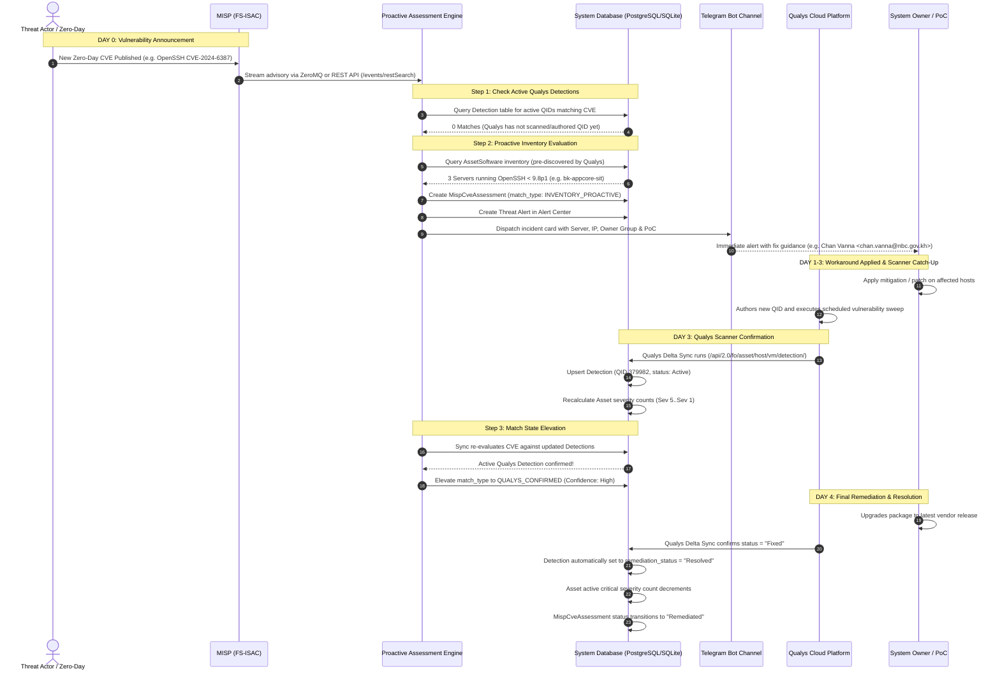

# Qualys & MISP (FS-ISAC) Integration Guide: How They Work Together Without Conflict

This document explains the technical architecture, data flow, synchronization lifecycle, and conflict-prevention guarantees between **Qualys Cloud Platform** and **MISP (FS-ISAC)** threat intelligence within the Risk Alert Dashboard.

---

## 1. Executive Summary & Core Philosophy

Security operations teams frequently encounter a fundamental operational dilemma:
- **Active Scanners (Qualys)** are exceptionally precise and provide definitive diagnostic proof, but they are **inherently reactive** — there is a lag between a vulnerability announcement, scanner signature authorship (QIDs), and scheduled scanning sweeps.
- **Threat Intelligence (MISP / FS-ISAC)** provides **early-warning advisories** within minutes of a zero-day disclosure, but threat feeds cannot directly verify whether a specific host's service is actually exposed or patched.

This platform unifies both systems into a **synchronized defense-in-depth model**:

| System | Role | Primary Strength | Timing |
|---|---|---|---|
| **MISP (FS-ISAC)** | **Early Warning Radar** | Identifies at-risk infrastructure within seconds of vulnerability disclosure. | **Day 0 (Instant)** |
| **Qualys VM** | **Scanner of Record** | Provides definitive diagnostic proof, port-level validation, and audit compliance. | **Day 1–7 (Scheduled)** |

```
              ┌────────────────────────────────────────────────────────┐
              │               TIMELINE OF A ZERO-DAY THREAT             │
              └────────────────────────────────────────────────────────┘

  Day 0: Vulnerability Disclosed
  ─────────────────────────────────────────────────────────────────────────────►
  09:00 AM   MISP publishes emergency CVE advisory (FS-ISAC)
  09:01 AM   ⚡ MISP Engine matches against Qualys-discovered software inventory (AssetSoftware)
             🚨 Proactive Alert generated: [INVENTORY_PROACTIVE] (High Confidence)
             📱 Telegram dispatched to SecOps with Server Name, IP, Owner Group & PoC
             🔧 Sysadmin applies temporary workaround or early vendor patch

  Day 3: Qualys Signature Released
  ─────────────────────────────────────────────────────────────────────────────►
  14:00 PM   Qualys releases QID for the CVE; scheduled scanner sweep runs
  14:05 PM   🛡️ Host detection flagged in Qualys; Engine elevates match to [QUALYS_CONFIRMED]
             📊 Active severity counters updated with raw Qualys Severity 1–5

  Day 4: Remediation Verified
  ─────────────────────────────────────────────────────────────────────────────►
  10:00 AM   Sysadmin deploys patch; Qualys Delta Sync confirms status = "Fixed"
             ✅ Detection automatically transitions to "Resolved"; Active severity count drops
             🎉 Threat Alert marked "Remediated"
```

---

## 2. End-to-End System Architecture

The following sequence diagram details how MISP and Qualys operate concurrently without competing for state or overwriting data:



---

## 3. Why Qualys and MISP Never Conflict: Architectural Proofs

A common concern in multi-source vulnerability platforms is data inconsistency:
- *Will MISP overwrite Qualys scan results?*
- *Will an asset be counted twice in risk calculations?*
- *What happens when MISP reports a vulnerability before Qualys sees it?*

The platform enforces **four structural conflict-prevention guarantees**:

### Proof 1: Data Model & Responsibility Separation

Qualys and MISP write to completely separate, non-overlapping tables in the database:

| Domain | Table | Sole Author | Purpose |
|---|---|---|---|
| **Infrastructure Reality** | `assets` | **Qualys Sync** | Discovered hosts, IPs, OS families, tags, and raw severity counters (Sev 1–5). |
| **Vulnerability Detections** | `detections` | **Qualys Sync** | Verified scanner findings (QID, port, protocol, diagnostic proof). |
| **Remediation Knowledge** | `knowledge_base` | **Qualys Sync** | Vendor solutions, patch URLs, CVSS scores, and RTI flags. |
| **Software Inventory** | `asset_software` | **Qualys Sync (Read by MISP)** | Installed packages, versions, and paths parsed from scanner diagnostics. |
| **Threat Intelligence** | `misp_cve_assessments` | **MISP Engine** | Emergency CVE advisories, assessment reports, and confidence ratings. |
| **Actionable Alerts** | `alerts` | **Engine & Sync Service** | Centralized alerts for host risk breaches and threat intelligence. |

> [!IMPORTANT]
> **Key Architecture Rule**: MISP **never** writes to the `detections` or `assets` tables. It treats Qualys data as an authoritative, read-only baseline of infrastructure inventory.

---

### Proof 2: Non-Conflicting Vulnerability & Severity Tracking

The host's vulnerability posture is categorized **exclusively** by native **Qualys Severity 1 to 5** via [`RiskEngine.count_asset_severities()`](file:///Users/kimsrung/workspace/nbc/dashboard_alert/backend/app/services/risk_engine.py) using active `Detection` records:

- When MISP discovers an at-risk server on Day 0, it creates a `MispCveAssessment` record and displays it in the **Threat Alert Center**.
- **It does NOT artificially create Qualys detections or inflate scanner severity counters**.
- Once Qualys scans the host on Day 3 and creates an active `Detection`, the vulnerability enters the active severity counter (`critical_vulns` for Sev 5) organically.
- This ensures compliance audit reports strictly reflect scanner-verified data while operational security teams still receive Day 0 early warnings.

---

### Proof 3: Seamless State Machine Elevation (`PROACTIVE` $\rightarrow$ `CONFIRMED`)

When an advisory is evaluated in [`ProactiveAssessmentEngine.assess_cve()`](file:///Users/kimsrung/workspace/nbc/dashboard_alert/backend/app/services/proactive_assessment_engine.py), it follows an ordered, non-conflicting priority chain:

```python
# STEP 1: Has Qualys scanner already confirmed an active detection for this CVE?
qualys_matches = await cls._check_qualys_detections(db, cve_id)
if qualys_matches:
    match_type = "QUALYS_CONFIRMED"
    confidence = "High (Scanner Verified)"
else:
    # STEP 2: Qualys has not flagged it yet. Check software inventory (AssetSoftware)
    inventory_matches = await cls._check_inventory_software(db, product, vuln_versions)
    if inventory_matches:
        match_type = "INVENTORY_PROACTIVE"
        confidence = "High (Installed Package Match)"
    else:
        # STEP 3: Check OS platform match
        os_matches = await cls._check_inventory_os(db, product, vuln_versions)
        if os_matches:
            match_type = "INVENTORY_PROACTIVE"
            confidence = "Medium (Target OS Platform)"
        else:
            match_type = "NO_ASSETS_AFFECTED"
```

#### State Transition Logic:
1. **Day 0**: `_check_qualys_detections` returns empty $\rightarrow$ Falls through to Step 2 $\rightarrow$ Marks **`INVENTORY_PROACTIVE`**.
2. **Day 3**: Qualys scans and creates detection $\rightarrow$ `_check_qualys_detections` returns true $\rightarrow$ Elevates to **`QUALYS_CONFIRMED`**.
3. **No Overwrites**: If an advisory was already confirmed by Qualys, the engine preserves `QUALYS_CONFIRMED` over proactive inventory matches:
   ```python
   if record.match_type == "QUALYS_CONFIRMED" and match_type != "QUALYS_CONFIRMED":
       logger.info(f"Preserving QUALYS_CONFIRMED match for {cve_id} over proactive pre-scan.")
   ```

---

### Proof 4: Remediation Synchronization & De-duplication

- **When a finding is fixed**: When sysadmins deploy a patch and Qualys executes an incremental delta sync, Qualys returns status `Fixed`. [`SyncService`](file:///Users/kimsrung/workspace/nbc/dashboard_alert/backend/app/services/sync_service.py) automatically transitions the detection's remediation status to `Resolved` and recalculates the asset score down to zero.
- **Telegram Cooldown**: Both Qualys asset breach alerts and MISP advisory alerts honor a **6-hour cooldown window** (`TELEGRAM_COOLDOWN_HOURS`) per asset/CVE. This prevents redundant notifications or alert storms across systems.

---

## 4. Step-by-Step Walkthrough: OpenSSH regreSSHion (`CVE-2024-6387`)

To understand the interaction in practice, consider the real-world scenario of **CVE-2024-6387** (OpenSSH Remote Code Execution):

### Phase 1: Normal Operation (Pre-Zero-Day)
- Qualys runs regular scans across 74 enterprise servers.
- During sync, [`SyncService._sync_discovered_software()`](file:///Users/kimsrung/workspace/nbc/dashboard_alert/backend/app/services/sync_service.py) regex parses diagnostic text from SSH discovery QIDs:
  - Host `bk-appcore-sit` (`10.10.20.15`) has diagnostic proof: `OpenSSH_8.2p1 Ubuntu-4ubuntu0.13`.
  - The engine inserts a record into `AssetSoftware`:
    ```json
    {
      "asset_id": 12,
      "product_name": "openssh",
      "version": "8.2p1",
      "package_name": "openssh-server",
      "install_path": "/usr/sbin/sshd",
      "port": 22
    }
    ```
- Asset `bk-appcore-sit` is assigned to **Owner Group**: `AppCore_Team`, with **PoC**: `Chan Vanna <chan.vanna@nbc.gov.kh>`.

---

### Phase 2: Day 0 Threat Arrival via MISP
- **Time**: July 1, 2024, 09:00 UTC.
- FS-ISAC publishes an emergency advisory to MISP:
  - **CVE ID**: `CVE-2024-6387`
  - **Product**: `openssh`
  - **Vulnerable Versions**: `< 9.8p1`
  - **Severity**: `Critical` (CVSS 8.1)
  - **Recommended Action**: Upgrade to OpenSSH 9.8p1 or set `LoginGraceTime 0` in `sshd_config`.
- **Qualys Status**: Qualys has **not** authored a detection signature yet. Qualys API returns zero detections for `CVE-2024-6387`.
- **Platform Execution**:
  1. MISP sync ingests advisory.
  2. `_check_qualys_detections` $\rightarrow$ 0 results.
  3. `_check_inventory_software` compares installed version `8.2p1` against criteria `< 9.8p1`.
  4. Using [`ver_cmp("8.2p1", "9.8p1")`](file:///Users/kimsrung/workspace/nbc/dashboard_alert/backend/app/services/proactive_assessment_engine.py), the comparison returns `-1` (vulnerable).
  5. The engine creates a `MispCveAssessment` record:
     - **Match Type**: `INVENTORY_PROACTIVE`
     - **Confidence**: `High (Installed Package Match)`
     - **Evidence**: `Installed package 'openssh-server' v8.2p1 at /usr/sbin/sshd (listening on port 22)`
  6. Telegram dispatches an immediate incident card:
     ```
     🛡️ [FS-ISAC THREAT INTELLIGENCE ADVISORY]
     ━━━━━━━━━━━━━━━━━━━━━━━━━━
     Advisory: CVE-2024-6387
     Threat: Critical OpenSSH Remote Code Execution (regreSSHion)
     Severity: 🔴 CRITICAL (CVSS: 8.1)
     Assessment Status: ⚡ [PROACTIVE PRE-SCAN MATCH]
     Warning: Qualys has not flagged this yet! Identified proactively via server software inventory.

     Target Product: openssh (Criteria: < 9.8p1)
     Affected Infrastructure (1 Server):
     • bk-appcore-sit (10.10.20.15)
       ├ Owner: AppCore_Team
       ├ PoC: Chan Vanna <chan.vanna@nbc.gov.kh>
       ├ Evidence: Installed package 'openssh-server' v8.2p1 at /usr/sbin/sshd (listening on port 22)
       └ Confidence: High

     Verification Command: ssh -V || dpkg -l | grep openssh
     Recommended Action: Upgrade OpenSSH to 9.8p1 or set LoginGraceTime 0 in sshd_config.
     ```

---

### Phase 3: Day 3 Qualys Scanner Sweep
- **Time**: July 4, 2024.
- Qualys releases QID **`379982`** (*OpenSSH Remote Code Execution Vulnerability (regreSSHion)*).
- Scheduled scanner sweep inspects `10.10.20.15` on port 22 and confirms the vulnerability.
- In `dashboard_alert`:
  1. Qualys Delta Sync runs.
  2. Ingests QID `379982` as an active `Detection` on `bk-appcore-sit`.
  3. Batch KnowledgeBase enrichment fetches solution and RTI flags (RCE = 1.5x, Exploit Public = 1.4x).
  4. [`RiskEngine`](file:///Users/kimsrung/workspace/nbc/dashboard_alert/backend/app/services/risk_engine.py) updates `bk-appcore-sit` severity counters: Sev 5 (`critical_vulns`) increments, updating the host's active severity counters in real-time.
  5. The proactive engine re-evaluates `CVE-2024-6387`. `_check_qualys_detections` now finds active QID `379982`.
  6. The advisory status in the Alert Center seamlessly transitions from **`INVENTORY_PROACTIVE`** to **`QUALYS_CONFIRMED`**.

---

### Phase 4: Remediation & Verification
- **Time**: July 5, 2024.
- Sysadmin Chan Vanna updates the package: `apt-get install --only-upgrade openssh-server` (upgraded to `9.8p1`).
- Next Qualys Delta Sync runs:
  - Qualys scanner detects port 22 now runs `OpenSSH_9.8p1`.
  - Qualys marks QID `379982` as `status="Fixed"`.
  - `SyncService` updates detection to `remediation_status="Resolved"` and `updated_by="Qualys Delta Sync"`.
  - Host active critical severity count decrements in real-time (`critical_vulns` drops).
  - `AssetSoftware` is updated with version `9.8p1`.
  - Proactive engine re-evaluates criteria `< 9.8p1` $\rightarrow$ evaluates to false $\rightarrow$ Threat advisory marks `0 servers affected (Clean)`.

---

## 5. Secondary Case Study: Library Matching (xz-utils `CVE-2024-3094`)

A similar lifecycle applies to embedded libraries such as **`CVE-2024-3094`** (the malicious backdoor in upstream `xz-utils` versions `5.6.0` and `5.6.1`):

1. **Day 0**: Threat intelligence flags `xz-utils` versions `5.6.0, 5.6.1`.
2. **Product Alias Mapping**: The engine's [`PRODUCT_ALIASES`](file:///Users/kimsrung/workspace/nbc/dashboard_alert/backend/app/services/proactive_assessment_engine.py) maps `xz-utils` to system packages `["xz", "xz-utils", "liblzma", "liblzma5"]`.
3. **Inventory Match**: The engine scans `AssetSoftware` for hosts with `package_name="liblzma5"` and versions matching `5.6.0` or `5.6.1`.
4. **Immediate Alert**: Identifies exposed build servers and container hosts days before active scanners could detect the obfuscated payload.

---

## 6. Summary Comparison Matrix: Qualys vs. MISP

| Capability / Behavior | Qualys Cloud Platform | MISP Threat Intelligence (FS-ISAC) | Combined Platform Synergy |
|---|---|---|---|
| **Primary Data Ingestion** | Scanned hosts & QID detections | Threat advisories & CVE metadata | Scanned reality + threat intelligence |
| **Speed to Advisory** | Moderate (1–7 days for QID authoring) | Instant (Minutes from disclosure) | **Zero-day protection without scanner lag** |
| **Verification Method** | Active network / authenticated probes | Package & version inventory matching | Pre-scan evaluation verified later by scanner |
| **Database Ownership** | `assets`, `detections`, `knowledge_base` | `misp_cve_assessments` | **Zero table conflicts or state overwrites** |
| **Severity Counter Impact** | Primary driver of `Asset.critical_vulns`..`info_vulns` | Generates Alert Center threat advisories | Native Qualys severities + proactive alert cards |
| **Remediation Trigger** | Scans host; marks status = `Fixed` | Analyst marks `Remediated` in UI | Automatic delta resolution with manual override |
| **Telegram Notifications** | Excluded from routine scan sync | Critical & High proactive matches | Formatted incident cards with Owner & PoC |

---

## 7. Conclusion

Qualys and MISP do not compete or conflict because they solve **two fundamentally different halves of the cybersecurity problem**:

1. **Qualys is the Foundation of Truth**: It continuously discovers hosts, operating systems, and installed software packages.
2. **MISP is the Velocity Layer**: It uses Qualys's discovered software inventory to sound the alarm on emerging zero-day threats **days before the scanner itself can sweep the network**.

When combined, your security team achieves both **maximum speed (Day 0 response)** and **maximum rigor (scanner-confirmed audit compliance)**.
