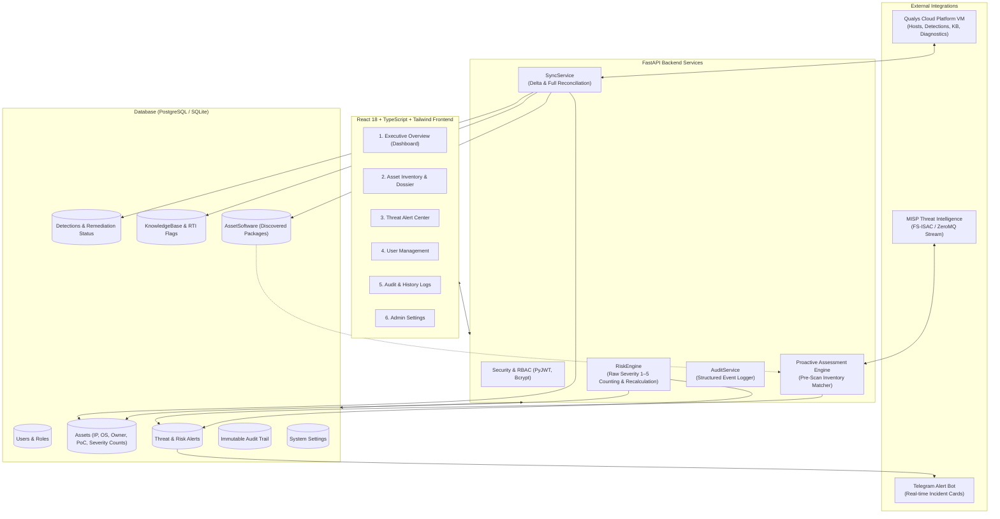
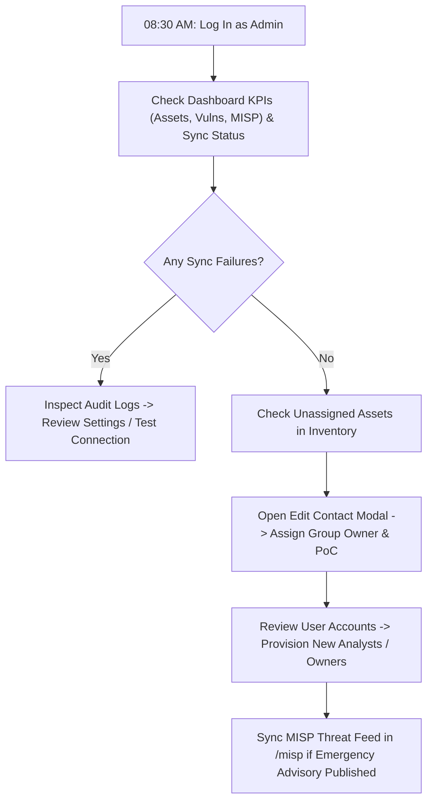
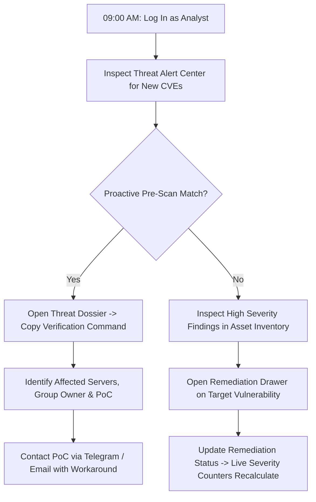
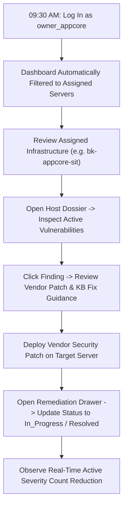
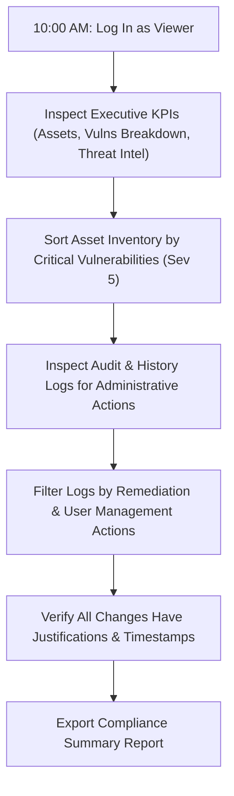

# Platform Overview & Operational Workflow Guide

This document provides a comprehensive overview of the **Risk Alert Dashboard & Remediation Platform**. It describes the six core functional modules, the underlying data architecture, the role-based access control (RBAC) model, and step-by-step day-in-the-life operational workflows for each user role.

---

## 1. Platform Mission & Architecture

The platform bridges the gap between **active vulnerability scanning (Qualys)** and **rapid threat intelligence (MISP / FS-ISAC)**. It empowers security operations (SecOps) teams, system administrators, and executive leadership to discover vulnerabilities, evaluate zero-day threats proactively, coordinate remediation with server owners and Points of Contact (PoCs), and maintain an immutable compliance audit trail.



---

## 2. Deep-Dive: The Six Core Modules

### Module 1: Executive Overview (`DashboardPage`)
The Executive Overview provides leadership and SecOps managers with real-time visibility into overall infrastructure health, vulnerability posture, and sync operations.

```
┌────────────────────────────────────────────────────────────────────────────────────────┐
│  EXECUTIVE OVERVIEW                                    [Sync Status: Idle] [Sync Now ▼]│
├───────────────────────────────┬───────────────────────────────┬────────────────────────┤
│ Assets Monitored: 74          │ Total Vulnerabilities: 1,420  │ MISP Threat Advisories:│
│ Scoped in Qualys VMDR         │ [5] 14  [4] 48  [3] 210 ...   │ 8 Advisories (2 matched│
├───────────────────────────────┴───────────────────────────────┴────────────────────────┤
│  Qualys Severity Distribution    Top OS Families          Real-Time Threat Intel (RTI) │
│  • Severity 5 (Critical): 14     • Linux (52)             • Ransomware: 4              │
│  • Severity 4 (High): 48         • Windows (18)           • Active in Wild: 6          │
│  • Severity 3 (Medium): 210      • Network/App (4)        • Public Exploit: 9          │
│  • Severity 2 (Low): 512                                  • Zero-Day: 2                │
│  • Severity 1 (Info): 636                                                              │
├────────────────────────────────────────────────────────────────────────────────────────┤
│  Most Affected Infrastructure (Ranked by Critical Sev 5 & High Sev 4 Detections)       │
│  • bk-appcore-sit (Sev 5: 3, Sev 4: 8, Total: 42)                                      │
│  • bk-dbprod-01   (Sev 5: 2, Sev 4: 5, Total: 28)                                      │
└────────────────────────────────────────────────────────────────────────────────────────┘
```

#### Key Capabilities:
- **Minimalist 3-KPI Metric Cards**:
  1. **Assets Monitored**: Total host infrastructure scoped in Qualys VMDR with direct link to inventory.
  2. **Total Vulnerabilities**: Total active findings across the fleet, accompanied by the live 5-severity pill breakdown (`Sev 5` through `Sev 1`).
  3. **MISP Threat Advisories**: Total threat intelligence advisories tracked and the number of exposed servers in the fleet.
- **Sync Status Pill & Action Dropdown**:
  - Displays the last sync timestamp, last full reconciliation time, active mode (`delta` vs `full`), and execution status (`Idle`, `Syncing`, `Error`).
  - Dropdown allows administrators to trigger an **Incremental Delta Sync** (fast update querying modified findings) or a **Full Reconciliation Sync** (full catalog sweep detecting decommissioned hosts).
- **Visual Analytics**:
  - **Qualys Severity Distribution**: Direct percentage bars for raw Qualys Severity 1 to 5 (eliminating artificial synthetic risk scores).
  - **Top Operating Systems**: Distribution of hosts across Linux, Windows, and appliance platforms.
  - **Real-Time Threat Intel (RTI) Breakdown**: Aggregated count of vulnerabilities with active ransomware associations, in-the-wild exploitation, public exploit code, or zero-day flags.
- **Most Affected Infrastructure**: Fast-access table prioritizing servers by active Severity 5 (Critical) and Severity 4 (High) detections.

---

### Module 2: Asset Inventory & Host Dossier (`AssetsPage` & `AssetDetailPage`)
The Asset Inventory manages all discovered infrastructure, host metadata, Qualys detections, installed software inventory, and remediation workflows.

#### 1. Paginated Inventory Table
- **Severity Breakdown (`SeverityPills`)**: Replaced artificial synthetic risk scores with raw Qualys Severity 1–5 pills (`[5]` Critical, `[4]` High, `[3]` Medium, `[2]` Low, `[1]` Info) and total open findings.
- **Default Priority Sorting**: Automatically sorts by Severity 5 (Critical) detections descending (`critical_vulns desc`), followed by High and Total detections.
- **Full Datetime Precision**: The "Last Scanned" timestamp displays in full `YYYY-MM-DD HH:mm:ss` format in Phnom Penh time (`Asia/Phnom_Penh` / UTC+7), exactly matching the Audit Log standard.
- **Multi-Field Search**: Searches across Server Name, IP Address, IPv6, FQDN, Operating System, Tags, and Point of Contact (PoC Name / PoC Email).
- **Filters**: Quickly filter hosts by Severity tier, OS Family (`Linux`, `Windows`), and Flagged Risky toggle (`critical_vulns > 0`).

#### 2. The Two-Tier Ownership & Contact Model
To accommodate enterprise environments where operational teams use shared service accounts while individual engineers are responsible for technical response, the platform decouples ownership into two distinct tiers:

```
┌───────────────────────────────────────────────────────────────────────────┐
│                    TWO-TIER HOST CONTACT ARCHITECTURE                     │
├──────────────────────────────────────┬────────────────────────────────────┤
│ Tier 1: Group Ownership Account      │ Tier 2: Individual Point of Contact│
│ (`owner_username` / `owner_id`)      │ (`poc_name` / `poc_email`)         │
├──────────────────────────────────────┼────────────────────────────────────┤
│ • Represents the responsible team   │ • Represents the specific engineer │
│   (e.g., `owner_appcore`, `DB_owner`)│   (e.g., `Chan Vanna`)             │
│ • Used for RBAC Login & Scoping      │ • Display and notification only    │
│ • Strictly filtered to role `owner`  │ • No login credentials required    │
│ • Enforces server access boundaries  │ • Directly included in Telegram    │
│                                      │   incident alerts & dossiers       │
└──────────────────────────────────────┴────────────────────────────────────┘
```

#### 3. Asset Editing Modal (`EditAssetModal`)
- Security analysts and administrators can open the **Edit Contact & Owner** modal on any asset.
- **Server Name**: Friendly display name override (e.g. `bk-appcore-sit`).
- **Owner Group**: Dropdown strictly populated with users possessing `role == "owner"`, completely excluding administrative or viewer accounts.
- **PoC Name & Email**: Direct human contact details (e.g., `Chan Vanna`, `chan.vanna@nbc.gov.kh`).

#### 4. Host Dossier & Software Inventory (`AssetDetailPage`)
- **Metadata Cards**: Displays IP, IPv6, FQDN, NetBIOS, OS Family, last Qualys scan full datetime (`YYYY-MM-DD HH:mm:ss`), and the Host Ownership & PoC badge.
- **Qualys Severity Stat Cards**: Five dedicated counter cards for Sev 5 (Critical), Sev 4 (High), Sev 3 (Medium), Sev 2 (Low), and Sev 1 (Info), alongside total detections.
- **Qualys Detections Catalog**: Complete table of all findings on the host with QID, Title, Severity (1–5), Status (`Active`, `New`, `Re-Opened`, `Fixed`), Protocol/Port, and Remediation Status.
- **Discovered Software Inventory (`AssetSoftware`)**: Lists software discovered from scanner diagnostics (OpenSSH, Nginx, Apache HTTPD, PHP, PostgreSQL, Linux Kernel), showing package names, versions, install paths, and listening ports. This inventory directly powers proactive MISP matching.
- **Slide-Over Remediation Drawer**:
  - Clicking any detection opens a drawer displaying vendor solutions, patch URLs, CVSS scores, RTI threat flags, and raw scanner diagnostic proof.
  - **Rich HTML Solution Rendering**: Automatically sanitizes and renders Qualys KnowledgeBase solutions, workarounds, consequences, and diagnostics in styled HTML (stripping raw `<P>`, `<A>`, `<UL>`, and `<LI>` tags).
  - Allows updating remediation status: `Open`, `In_Progress`, `Acknowledged`, `False_Positive`, and `Resolved`.
  - Adding remediation notes and saving **automatically recalculates the parent asset's active severity counters in real-time** (`critical_vulns`, `high_vulns`, `medium_vulns`, `low_vulns`, `info_vulns`, and `total_vulns`).
- **Admin Asset Deletion**: Administrators can permanently delete decommissioned or stale assets (`DELETE /api/v1/assets/{id}`), with automatic cascade deletion of associated detections, software inventory, and alert logs.

---

### Module 3: Threat Alert Center (`AlertsPage`)
The Threat Alert Center consolidates intelligence from external threat feeds (MISP / FS-ISAC) into a unified triage dashboard.

#### Key Capabilities:
- **Dual-Source Correlation**:
  - **`QUALYS_CONFIRMED`**: Scanner has already detected the vulnerability on active hosts.
  - **`INVENTORY_PROACTIVE`**: Early-warning match! Identified by comparing installed software versions in `AssetSoftware` against threat criteria **before** Qualys authors or runs a scan.
- **Alert Metrics**: Displays total active alerts, critical/high breakdown, and count of exposed servers.
- **Centralized Ingestion Architecture**: The manual "Sync Feed" button is hosted strictly in the **MISP Threat Feed** sub-module (`/misp`), ensuring clean administrative segregation. The Alert Center provides a dedicated database **Refresh** button.
- **Slide-Over Threat Advisory Dossier**:
  - Clicking an alert opens the full dossier displaying CVE ID, CVSS score, publisher source (`FS-ISAC` or `MISP`), affected product, and vulnerable criteria.
  - **Affected Infrastructure List**: Shows each affected server with its IP address, diagnostic evidence, Group Owner, and individual PoC contact.
  - **Shell Verification Command**: One-click copyable bash command to verify package versions on target hosts (e.g., `ssh -V || dpkg -l | grep openssh`).
  - **Remediation Action Form**: Allows analysts to update alert status to `Acknowledged`, `Remediated`, or `False_Positive`.

#### Sub-Module: MISP Threat Feed (`MispPage` — Admin Only)
Located directly under Alert Center in the sidebar navigation (accessible at `/misp` strictly to users with `role == 'admin'`).
- **Centralized Threat Ingestion**: Houses the primary **"Sync Feed"** button to pull new CVE advisories on-demand, run inventory matching, and record sync metrics.
- **Comprehensive CVE Catalog**: Displays all ingested threat advisories from MISP (FS-ISAC), including both affected infrastructure matches and clean advisories (`NO_ASSETS_AFFECTED`).
- **Sorting & Filtering Toolbar**: Sort by Affected Servers, CVE ID, Severity, CVSS score, or Date Added. Filter by Match Type, Severity, and Source.
- **Slide-Over Threat Dossier**: Detailed advisory view displaying verification commands, sanitized HTML remediation guidance, and affected server details with Group Owner and PoC.

---

### Module 4: User Management (`UsersPage`)
The User Management module enforces enterprise Role-Based Access Control (RBAC).

#### RBAC Roles:
1. **Admin (`admin`)**: Unrestricted platform control. Can create/edit users, manage system settings, assign server owners, trigger sync jobs, delete assets, and test Telegram alerts.
2. **Analyst (`analyst`)**: Security triage and incident response. Can inspect all infrastructure, assign server owners and PoCs, update remediation statuses in drawers, and resolve threat alerts. Cannot edit system settings, delete assets, or modify user accounts.
3. **Owner (`owner`)**: Scoped Host Ownership account (e.g., `owner_appcore`). **Strictly scoped to assets assigned to their user ID** (`Asset.owner_id == user.id`). Can only view and update remediation statuses on their assigned servers.
4. **Viewer (`viewer`)**: Read-only audit access. Can view executive dashboard KPIs, browse all assets, inspect KB remediation advice, and view threat alerts. All write/edit endpoints return HTTP 403 Forbidden.

#### Administrative Capabilities:
- **User Catalog**: Displays username, full name, email, role badge, account status, and timestamps.
- **Create User**: Modal to provision new accounts with secure password hashing (Bcrypt).
- **Edit User**: Modify user full names, email addresses, and roles.
- **Toggle Active Status**: Temporarily disable accounts without deleting audit history.
- **Delete User**: Permanently remove accounts (with protection preventing deletion of the last admin).

---

### Module 5: Audit & History Logs (`AuditLogsPage`)
The Audit & History Logs module provides an immutable, append-only record of all administrative, security, and synchronization operations for compliance and accountability.

#### Tracked Events:
- **Authentication**: `AUTH_LOGIN`, `AUTH_LOGIN_FAILED`.
- **User Management**: `USER_CREATE`, `USER_UPDATE`, `USER_DELETE`, `USER_DEACTIVATE`.
- **Asset Operations**: `UPDATE_ASSET_METADATA`, `DELETE_ASSET`.
- **Remediation Actions**: `UPDATE_REMEDIATION_STATUS`, `UPDATE_ALERT_STATUS`.
- **Sync Operations**: `QUALYS_DELTA_SYNC`, `QUALYS_FULL_SYNC`, `MISP_FEED_SYNC`, `MISP_EVENT_TRIGGERED`.
- **System Settings**: `UPDATE_SETTINGS`, `DISPATCH_TELEGRAM_TEST`.

#### Interface Features:
- **Audit Table**: Shows timestamp (UTC), action pill, target type, target ID, target name, actor username & role, and source IP address.
- **Search & Filters**: Search across actions, targets, and actor usernames; filter by action category.
- **JSON Details Modal**: Click any log entry to view the full structured JSON payload (e.g., prior vs. updated status values, affected server counts, sync metrics).

---

### Module 6: Admin Settings (`SettingsPage`)
The Admin Settings module allows administrators to configure integrations, tune parameters, and execute connection diagnostics.

#### Configuration Sections:
1. **Qualys Cloud API**:
   - API Gateway URL (US, EU, India pods), username, password.
   - Sync Interval (hours) and Asset Tag filter scope (`QUALYS_TAG_FILTER`).
   - **Test Qualys Connection**: Validates authentication via `/api/2.0/fo/session/`.
2. **MISP Threat Intelligence**:
   - MISP Base URL (e.g. `https://misp.fsisac.com`).
   - API Auth Key.
   - **Creator Org Filter (`Orgc`)**: Configured to `FS-ISAC` (or `*` for all publishing organizations).
   - **Tag Filter**: Optional taxonomy filter (e.g. `vulnerability:CVE%`).
   - **ZeroMQ TCP Streaming**: Host, port (`50000`), credentials, and connection tester.
3. **Telegram Alert Bot**:
   - Bot Token and Target Chat ID.
   - Cooldown window in hours (`TELEGRAM_COOLDOWN_HOURS`, default: 6 hours).
   - **Alerting Policy**: Dispatches formatted HTML alert cards exclusively for proactive MISP threat intelligence matches (`INVENTORY_PROACTIVE` or `QUALYS_CONFIRMED`) affecting monitored server infrastructure. Routine Qualys scans are excluded from Telegram alerts to prevent notification fatigue.
   - **Send Test Alert**: Dispatches a sample formatted HTML incident card to verify Telegram bot setup.
4. **Raw Qualys Severity Tracking**:
   - Detections categorized directly by raw Qualys Severity 1–5 (Sev 5 Critical, Sev 4 High, Sev 3 Medium, Sev 2 Low, Sev 1 Info), eliminating artificial synthetic risk score and SLA age math.
5. **Simulate MISP Event Triggered**:
   - Diagnostic tool to simulate an incoming ZeroMQ threat stream (e.g., test `CVE-2024-6387`, product `openssh`, criteria `< 9.8p1`) and verify instant proactive matching against software inventory.
6. **API Documentation Access Credentials**:
   - Secures interactive Swagger UI (`/docs`) and OpenAPI schema (`/openapi.json`) with HTTP Basic Authentication.
   - Configure documentation username (default: `docs_admin`) and password (default: `docs123`) with show/hide toggle.
   - Credentials are saved to the database and reloaded immediately without restarting the service.

---

## 3. Role-Based Access Control (RBAC) Permissions Matrix

| Platform Capability / Endpoint | Admin (`admin`) | Analyst (`analyst`) | Owner (`owner`) | Viewer (`viewer`) |
|---|:---:|:---:|:---:|:---:|
| **View Executive Dashboard KPIs** | Full | Full | Scoped to Owned Assets | Full |
| **Trigger Qualys Scan Sync** | Yes | No | No | No |
| **Trigger MISP Threat Feed Sync (/misp)** | **Yes** | **No** | **No** | **No** |
| **Browse All Asset Inventory** | All Hosts | All Hosts | **Only Assigned Hosts** | All Hosts |
| **Edit Server Name, Owner & PoC** | Yes | Yes | No | No |
| **Delete Assets (`DELETE /assets/{id}`)** | Yes | No | No | No |
| **Update Remediation Drawer Status** | Yes | Yes | **Yes (Owned Hosts Only)** | No |
| **View Threat Alert Center** | All Alerts | All Alerts | **Only Alerts on Owned Hosts** | All Alerts |
| **Access MISP Threat Feed (/misp)** | **Yes** | **No** | **No** | **No** |
| **Resolve Threat Alerts** | Yes | Yes | No | No |
| **Manage Users (Create/Edit/Delete)** | Yes | No | No | No |
| **Inspect Audit & History Logs** | Yes | Yes | No | Yes |
| **Edit System Settings & API Keys** | Yes | No | No | No |
| **Test Telegram / Connection Testers** | Yes | No | No | No |

---

## 4. Day-in-the-Life Operational Workflows

### Workflow 1: System Administrator (`admin`)
*Persona: Sarah, Lead Infrastructure Security Engineer*



#### Step-by-Step Scenario:
1. **08:30 AM — Morning Health Check**:
   - Sarah logs into the dashboard (`admin`).
   - Checks the **Executive Overview**: Assets Monitored (74), Total Vulnerabilities (1,420 with 5-severity breakdown), and MISP Threat Advisories (8 advisories, 2 matched servers). Sync status shows `Idle`.
2. **09:00 AM — Managing New Infrastructure**:
   - Navigates to **Asset Inventory**. Notices two newly scanned database servers from the overnight Qualys sweep with unassigned ownership.
   - Clicks **Edit Contact & Owner** on `bk-dbprod-02`. Sets Server Name to `bk-dbprod-02`, assigns Owner Group to `DB_owner` (filtered to role `owner`), and sets PoC to `Sok Visal` (`sok.visal@nbc.gov.kh`).
3. **10:00 AM — Account Provisioning**:
   - Navigates to **User Management**. Provisions a new application owner account for the core banking team (`owner_bakong`, role: `Owner`).
4. **11:30 AM — Operational Maintenance**:
   - Navigates to **Admin Settings**. Verifies Qualys connection via **Test Qualys Connection**.
   - Clicks **Send Test Alert** to verify Telegram bot connectivity to the emergency SecOps channel.

---

### Workflow 2: Security Analyst (`analyst`)
*Persona: David, Security Operations Center (SOC) Analyst*



#### Step-by-Step Scenario:
1. **09:00 AM — Morning Threat Triage**:
   - David logs in as `analyst`.
   - Navigates to **Threat Alerts**. Identifies a new Critical advisory: `CVE-2024-6387` (OpenSSH regreSSHion), marked as **`INVENTORY_PROACTIVE`**.
2. **09:15 AM — Evaluating Exposure & Contacting PoC**:
   - Clicks on the advisory to open the **Threat Dossier Drawer**.
   - Inspects the affected server list: Server `bk-appcore-sit` (`10.10.20.15`) is running OpenSSH `8.2p1`.
   - Notes the assigned Owner Group (`AppCore_Team`) and PoC (`Chan Vanna <chan.vanna@nbc.gov.kh>`).
   - Copies the shell verification command: `ssh -V || dpkg -l | grep openssh`.
   - Reaches out to Chan Vanna with recommended temporary mitigation (`LoginGraceTime 0` in `sshd_config`).
3. **10:30 AM — Remediation Drawer Triage**:
   - Navigates to **Asset Inventory** and opens `bk-appcore-sit`.
   - Reviews findings in the **Remediation Drawer** rendered with rich HTML guidance.
   - Finds an older QID where the engineering team implemented compensating network firewall segmentation.
   - Updates status to **`Acknowledged`** with notes: *"Compensating firewall rule active on port 8443."*
   - Clicks **Save**. The parent asset's active severity counters (`critical_vulns`, `high_vulns`, `medium_vulns`, etc.) immediately refresh in real-time.

---

### Workflow 3: Server Group Owner (`owner`, e.g., `owner_appcore`)
*Persona: AppCore Operations Team (Shared Account)*



#### Step-by-Step Scenario:
1. **09:30 AM — Scoped Access Login**:
   - The team logs in using the shared credentials for `owner_appcore`.
   - The **Executive Overview** and **Asset Inventory** automatically enforce scoping: they **only** see the servers assigned to their ownership group (`bk-appcore-sit`, `bk-appcore-uat`). Other hosts (database servers, payment switches) are completely hidden.
2. **09:45 AM — Reviewing Incident & Fix Guidance**:
   - Receives an operational notification regarding OpenSSH on `bk-appcore-sit`.
   - Opens `bk-appcore-sit` in **Asset Inventory**.
   - Clicks on the OpenSSH vulnerability to open the **Remediation Drawer**.
   - Reads the step-by-step solution guidance: *"Upgrade to OpenSSH 9.8p1 or apply vendor backport patch."*
3. **11:00 AM — Patch Deployment & Status Update**:
   - Deploys the package update on the host via SSH: `apt-get install --only-upgrade openssh-server`.
   - In the Remediation Drawer, selects status **`Resolved`** with note: *"Upgraded to openssh-server 9.8p1-1ubuntu1."*
   - Clicks **Update Remediation Status**.
   - The asset's active critical vulnerability count drops immediately (e.g. Sev 5 pill decreases).
   - When the next Qualys sweep runs, Qualys verifies the fix and permanently marks the scanner detection `Fixed`.

---

### Workflow 4: Compliance Auditor / Executive (`viewer`)
*Persona: Elena, Internal IT Security Auditor*



#### Step-by-Step Scenario:
1. **10:00 AM — Executive Audit Review**:
   - Elena logs in as `viewer`.
   - Inspects the **Executive Overview**: Reviews total monitored infrastructure, the Qualys severity distribution bar, active vulnerability breakdowns, and MISP threat advisories.
2. **10:30 AM — Inspecting Asset Posture (Read-Only)**:
   - Navigates to **Asset Inventory**. Table defaults to sorting by critical vulnerabilities (`Sev 5`) descending.
   - Inspects host dossiers and opens remediation drawers to review HTML solution details and full scan datetimes (`YYYY-MM-DD HH:mm:ss`).
   - **Protection Enforcement**: Elena can read all fix details and notes, but action buttons (**Update Status**, **Delete Asset**, **Edit Contact**) are disabled or hidden, preventing unauthorized modifications.
3. **11:15 AM — Audit Trail Verification**:
   - Navigates to **Audit & History Logs**.
   - Filters logs by action `UPDATE_REMEDIATION_STATUS`.
   - Verifies that every vulnerability status change has an actor username, source IP, timestamp, and audit justification.
   - Inspects `QUALYS_DELTA_SYNC` and `QUALYS_FULL_SYNC` records to verify that scanner synchronization ran continuously without interruption.
   - Inspects host dossiers and opens remediation drawers.
   - **Protection Enforcement**: Elena can read all fix details and notes, but action buttons (**Update Status**, **Delete Asset**, **Edit Contact**) are disabled or hidden, preventing unauthorized modifications.
3. **11:15 AM — Audit Trail Verification**:
   - Navigates to **Audit & History Logs**.
   - Filters logs by action `UPDATE_REMEDIATION_STATUS`.
   - Verifies that every vulnerability status change has an actor username, source IP, timestamp, and audit justification.
   - Inspects `QUALYS_DELTA_SYNC` and `QUALYS_FULL_SYNC` records to verify that scanner synchronization ran continuously without interruption.

---

## 5. Summary Reference

| Resource | Documentation Link |
|---|---|
| **MISP Synchronization & Local Testing** | [`docs/MISP.md`](file:///Users/kimsrung/workspace/nbc/dashboard_alert/docs/MISP.md) |
| **Qualys Ingestion, Sync & Risk Engine** | [`docs/Qualys.md`](file:///Users/kimsrung/workspace/nbc/dashboard_alert/docs/Qualys.md) |
| **Qualys & MISP Conflict-Prevention Synergy** | [`docs/Qualys_MISP_work_together.md`](file:///Users/kimsrung/workspace/nbc/dashboard_alert/docs/Qualys_MISP_work_together.md) |
| **Technical Architecture & Developer Guide** | [`docs/developer_guide.md`](file:///Users/kimsrung/workspace/nbc/dashboard_alert/docs/developer_guide.md) |
